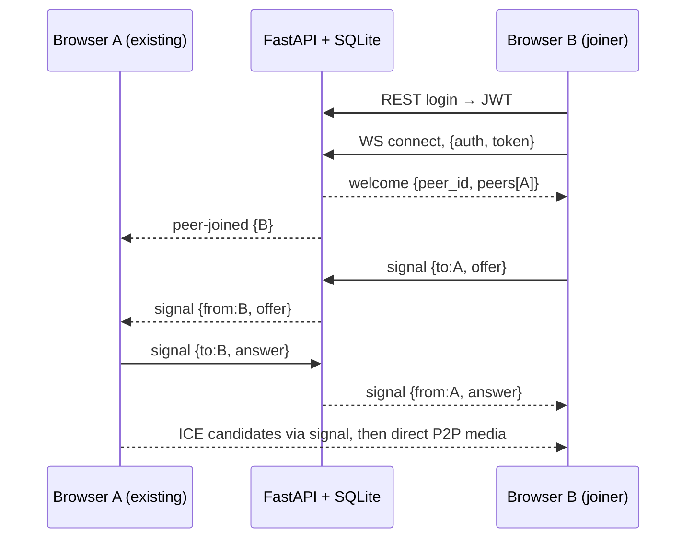

# Meet — Planning Documents

## 1. PRD
**Problem:** Small teams/students need a simple, self-hosted video meeting tool without third-party accounts.
**Users:** Registered users (hosts and participants). **Journeys:** register/login → create meeting → share invite link → others log in and join → talk, share screen, chat → host ends meeting.
**Features:** auth, create/join/end rooms, WebRTC audio/video (mesh, up to 6), screen share, mute/camera toggle, in-meeting chat with history, my-meetings list, dark mode.
**Acceptance:** two browsers in one room see/hear each other; chat persists; non-members cannot read history; only host can end a meeting.
**Success metrics:** join-to-first-video under ~5 s on LAN; zero unauthenticated API/WS access.

## 2. TRD
- **Frontend:** React 18 + Vite + react-router. Browser WebRTC APIs.
- **Backend:** FastAPI (Python). REST for auth/rooms; one WebSocket per participant for signaling + chat.
- **DB:** SQLite (WAL, foreign keys on, parameterized queries only).
- **Media:** P2P mesh. Each peer sends to every other peer. Works well up to ~4–6 people. Larger meetings need an SFU (LiveKit/mediasoup) — out of scope.
- **Auth:** bcrypt passwords, HS256 JWT (120 min), bearer header. WS auth via first message (token never in URL).
- **Security:** server-side authz on every route, input validation, rate limits, origin check on WS, size limits, security headers, no secrets in code.
- **Deployment:** run uvicorn behind an HTTPS reverse proxy (camera access requires HTTPS except on localhost). Single process (room state is in memory).

## 3. Workflow

Trust boundary: the server never trusts client IDs; identity comes from the verified JWT. Failure points: camera denied (join receive-only), NAT blocks P2P (needs TURN), WS drop (peer-left broadcast).

## 4. UI/UX
Pages: Login/Register, Dashboard (create, join by code/link, my meetings), Room (video grid, chat drawer, control bar), 404. Palette: neutral surface + indigo accent, light/dark via CSS variables. Components: tile, control button, chat panel. States: loading, empty, error, ended.

## 5. Schema (SQLite)
- `users(id PK, username UNIQUE NOCASE, email UNIQUE NOCASE, password_hash, created_at)`
- `rooms(id PK, code UNIQUE, name, host_id FK users, is_active, created_at, ended_at)`
- `messages(id PK, room_id FK rooms CASCADE, user_id FK users, content, created_at)` index (room_id, id)
- `sessions(id PK, room_id FK, user_id FK, joined_at, left_at)` index (room_id, user_id); also grants chat-history access.

## 6. Implementation plan
M1 DB + auth + tests → M2 rooms REST + tests → M3 WS signaling + chat + tests → M4 React auth/dashboard → M5 Room page (WebRTC, screen share, chat) → M6 cleanup, README.
